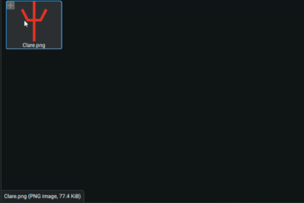
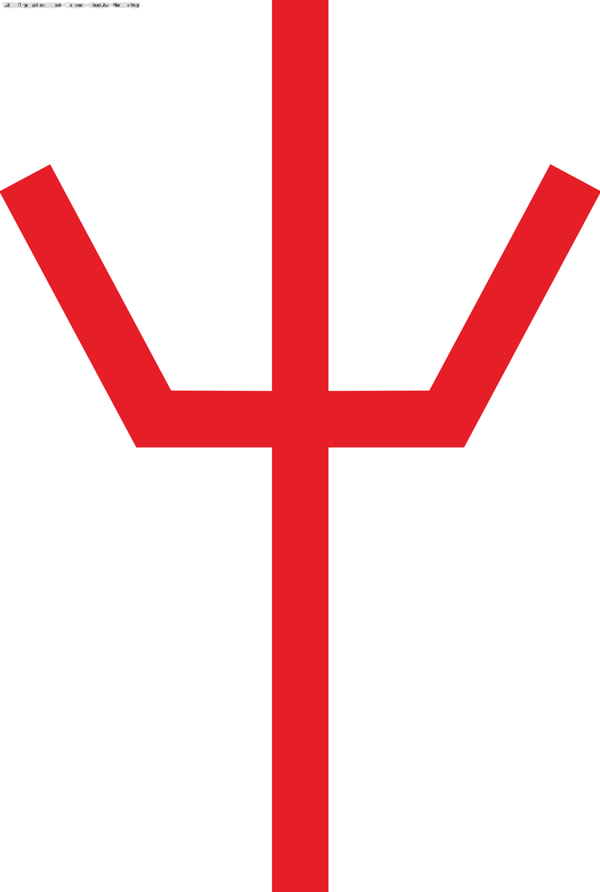

# SlopCoded-PNG-To-SVG
A Slop Coded-PNG-To-SVG Converter made by claude.ai for linux
# demo
<div align="center">
  
</div>
<div style="display: flex; gap: 10px; align-items: center;">
  
  
</div>
<p>Clare SVG credit: <a href="https://www.deviantart.com/vigoord/art/Claymore-Clare's-Organization-Symbol-2-901779657">vigoord</a></p>


# What claude.ai wrote down below 
# PNG to SVG (Linux)

Converts PNG files to true vector SVGs (color tracing with
[vtracer](https://github.com/visioncortex/vtracer)), then cleans up the edges so
straight lines stay straight and curves stay smooth. The SVG is saved next to
the PNG with the same name (`logo.png` -> `logo.svg`).

## Files

| File               | Purpose                                                        |
|--------------------|----------------------------------------------------------------|
| `png_to_svg.py`    | The program                                                    |
| `build.sh`         | Builds one self-contained executable at `dist/png_to_svg`      |
| `install.sh`       | Installs it to `~/.local/bin` and adds "Open With" for PNGs    |
| `diagnose.py`      | Finds which vtracer code path crashes, if you get a segfault   |
| `requirements.txt` | Python packages (for running from source)                      |

## Build and install

You need Python 3 with `venv` and internet access (for pip).

```
bash build.sh        # creates dist/png_to_svg
bash install.sh      # installs it for your user, no sudo needed
```

**Use Python 3.12 or 3.13.** vtracer's native extension has crashed
(segmentation fault) on Python 3.14. If `python3` on your system is 3.14:

```
PYTHON=python3.13 bash build.sh
```

(or create the interpreter with `uv`/`pyenv` and point `PYTHON` at it).

The binary bundles Python and its libraries, but it needs a glibc at least as
new as the machine that built it. Build on the oldest distro you want to
support.

## Use

- **File manager:** right-click a PNG > Open With > **Convert PNG to SVG**.
  Select several PNGs to convert them all. A desktop notification appears when
  finished (needs `notify-send`).
- **Terminal:**

```
png_to_svg image.png [more.png ...]
png_to_svg --no-smooth image.png     # keep vtracer's raw output
```

An existing SVG with the same name is overwritten. The installer does not make
this the default app for PNGs, so double-clicking still opens your image viewer.

## Run from source (no build)

```
python3.13 -m venv env && source env/bin/activate
pip install -r requirements.txt
python png_to_svg.py image.png
```

## How the edge cleanup works

vtracer follows the pixel staircase of an edge, which leaves straight diagonals
slightly wobbly. After tracing, each shape outline is resampled, corners are
detected, and then:

- straight stretches become exact `L` lines, with corners snapped to where
  neighboring lines meet;
- curved stretches are refit as a few cubic Béziers (within about 1 px);
- shapes smaller than ~24 px (e.g. tiny text) are left untouched.

Pure Python, no extra dependencies. If cleanup fails for any reason, the raw
vtracer output is kept.
